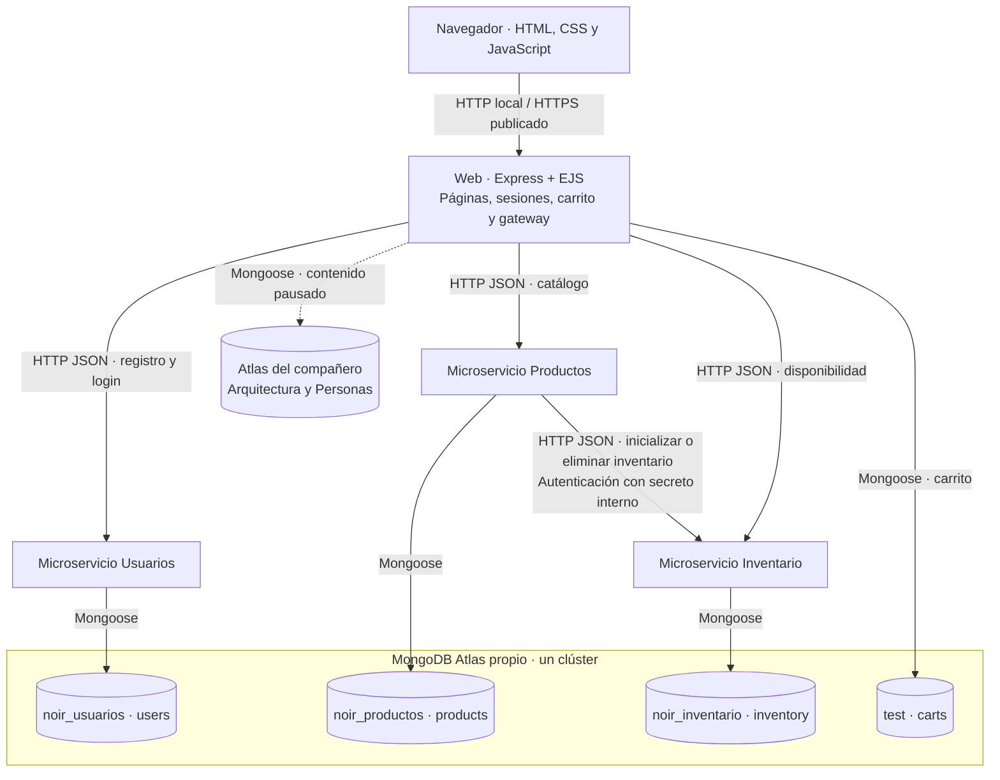
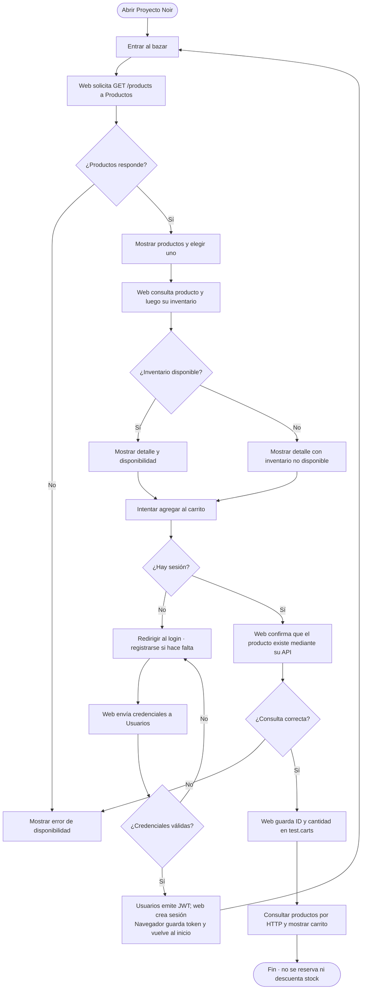
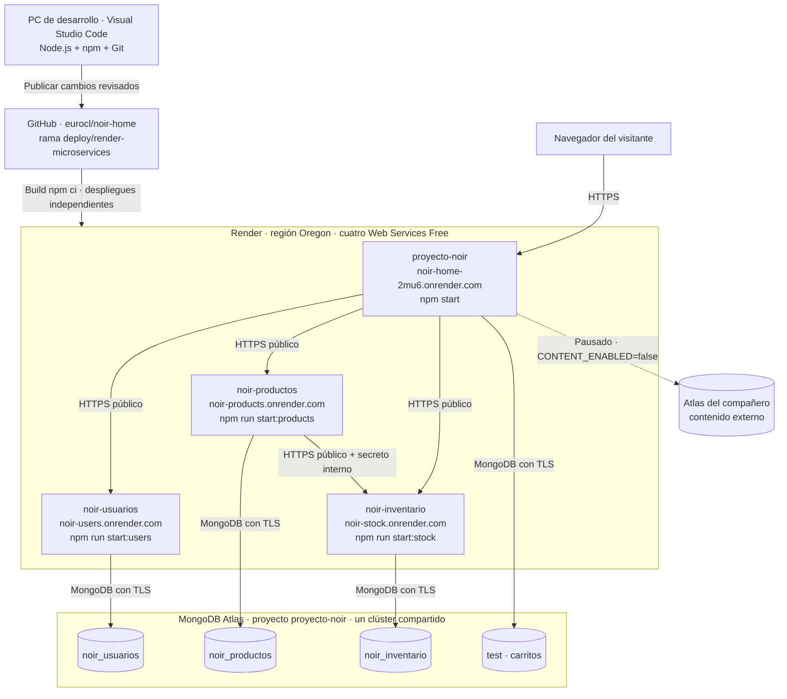

# Proyecto Noir · Guía de arquitectura, uso y exposición

Documento preparado el 20/09/2026 a partir del código y del despliegue realizado. Referencia del código publicado: `5b27b5e`, rama `deploy/render-microservices`. Las cantidades de documentos son las de la migración, no un contador en tiempo real.

## 1. Qué construimos

Proyecto Noir es una aplicación web de catálogo de arquitectura y productos para el hogar. La web presenta las páginas, gestiona las sesiones y el carrito. Separamos tres responsabilidades de negocio en APIs ejecutadas como procesos independientes: **usuarios, productos e inventario**.

Hay **cuatro servicios desplegados en Render: una web y tres microservicios de negocio**. Cada microservicio tiene una URL, un comando de inicio y una base lógica propios. Los tres comparten un clúster de MongoDB Atlas. Tener varias bases, por sí solo, no convierte una aplicación en microservicios: la separación también está en la ejecución y en la comunicación HTTP.

El código está en un único repositorio, con dependencias y utilidades compartidas. Eso permite desplegar procesos por separado, aunque los cambios en utilidades comunes requieren revisar los servicios afectados. No estamos afirmando que sean cuatro proyectos totalmente desacoplados.
ñ
## 2. Diagrama de arquitectura: responsabilidades y comunicación

Las flechas representan solicitudes o acceso a datos; las respuestas regresan por la misma conexión. La conexión punteada está implementada, pero desactivada actualmente.



La web cumple una función similar a un **BFF** (backend para la interfaz): consulta APIs y combina resultados para renderizar las páginas. También actúa como gateway en algunas rutas, pero no tenemos un producto independiente de API Gateway. El carrito continúa dentro de esta web.

Arquitectura y Personas son colecciones de contenido consultadas por la web. Una segunda conexión MongoDB no las convierte en dos microservicios.

## 3. Diagrama de flujo: desde el acceso hasta el carrito

Este flujo describe la navegación actual. Consultar el catálogo no exige iniciar sesión; agregar al carrito sí.



**Registro:** Usuarios valida los campos, calcula el hash bcrypt y guarda la cuenta en `noir_usuarios`. **Login:** verifica ese hash, emite un JWT de una hora y devuelve los datos públicos del usuario. La web regenera su sesión. El JavaScript del login guarda el token en `localStorage`; la sesión se identifica mediante una cookie.

**Crear un producto:** Productos genera un ID, solicita a Inventario inicializar sus existencias y guarda el producto sin campo `stock`. Si hay un error, intenta compensar. **Eliminarlo:** consulta el inventario, lo elimina y borra el producto; si falla, intenta restaurar el inventario cuando corresponde. Son operaciones entre servicios, sin una transacción distribuida. Una compensación también puede fallar y requerir revisión.

## 4. Diagrama de infraestructura: dónde corre cada parte



GitHub almacena y versiona el código; Render ejecuta los procesos; Atlas persiste los datos. La PC no tiene que estar encendida para visitar el sitio publicado. El nombre visible de un servicio y su URL pueden ser distintos: conservamos las URLs existentes después del cambio de nombre.

Los servicios Free se comunican por sus direcciones HTTPS públicas: no reciben tráfico por la red privada de Render. Render administra el puerto de cada proceso mediante `PORT`; los puertos 3000–3003 son para desarrollo local. [Documentación de Render Free](https://render.com/docs/free).

## 5. Dónde demostrar la separación

### En Visual Studio Code

Abrí **Archivo → Abrir carpeta** y elegí:

```text
C:\Users\europ\OneDrive\Desktop\noir-home-main\noir-home-main
```

Es la carpeta que contiene `package.json` y `app.js`. Si abriste la carpeta exterior, expandí la carpeta interior del mismo nombre.

```text
noir-home-main/
├── app.js                       Web, sesiones, carrito y contenido
├── services/
│   ├── users/
│   │   ├── server.js             Inicia el proceso Usuarios
│   │   └── app.js                Rutas de registro, login y perfil
│   ├── products/
│   │   ├── server.js             Inicia el proceso Productos
│   │   └── app.js                API de productos y coordinación con stock
│   ├── stock/
│   │   ├── server.js             Inicia el proceso Inventario
│   │   └── app.js                Modelo y API de inventario
│   ├── database-config.js       Elige la base de cada servicio
│   ├── client.js                Llamadas HTTP entre procesos
│   ├── runtime.js               Configuración común y health checks
│   ├── deployment.js            Puertos y URLs local/Render
│   └── internal-auth.js         Protege escrituras internas de inventario
├── routes/product-gateway.js    La web consulta las APIs
├── models/                      User, Product, Cart y contenido
├── middleware/auth.js           Verificación de JWT
├── views/                       Plantillas EJS
├── public/                      CSS, JavaScript e imágenes
├── scripts/start-services.js    Lanza cuatro procesos locales
├── tests/                       Pruebas de servicios y despliegue
├── package.json                 Dependencias y comandos
├── render.yaml                  Plantilla de infraestructura
└── .env.example                 Nombres de variables sin credenciales reales
```

Para exponer, abrí en este orden: `package.json` → los tres `server.js` → `services/database-config.js` → `services/client.js` → `routes/product-gateway.js`. Podés usar **Ctrl+P** y escribir el nombre de cada archivo. Mostrá `.env.example` cuando expliques configuración; el `.env` real contiene claves privadas.

La conexión global de Mongoose en cada proceso es independiente de la de los otros procesos. Tener modelos en una carpeta compartida no implica una única conexión en ejecución.

### En Render

Mostrá los cuatro servicios en el panel. En cada uno, revisá **Settings** para ver comando de inicio y rama, y **Logs / Events** para mostrar su ejecución y despliegue. Una carpeta distinta no basta como prueba: los cuatro despliegues son la evidencia de ejecución separada.

### En MongoDB Atlas

Entrá a `proyecto-noir`, seleccioná el clúster y abrí **Browse Collections** (explorador de datos). Mostrá:

| Responsabilidad | Base activa | Colección | Datos migrados |
|---|---|---|---|
| Cuentas | `noir_usuarios` | `users` | 7 |
| Catálogo de productos | `noir_productos` | `products` | 44 |
| Existencias | `noir_inventario` | `inventory` | 44 |
| Carrito, dentro de la web | `test` | `carts` | 3 |

Un producto y su inventario comparten el mismo identificador: `products._id = inventory._id`. La API de inventario presenta ese valor como `productId`. Es una referencia lógica entre servicios, no una clave foránea que MongoDB haga cumplir entre bases.

Las bases anteriores en inglés y las colecciones originales de usuarios/productos en `test` se conservaron como copias históricas; no representan los datos nuevos. `test.carts` sí sigue activa. La base `local` es interna de MongoDB y se mantiene.

## 6. Tecnologías y para qué las usamos

| Tecnología | Uso concreto |
|---|---|
| JavaScript y Node.js 24 | Lenguaje y ejecución del backend |
| Express 5 | Servidores web, rutas y middleware |
| EJS | Genera HTML en el servidor con los datos de las APIs |
| HTML, CSS y JavaScript del navegador | Interfaz, estilos e interacción |
| MongoDB Atlas | Persistencia de documentos en la nube |
| Mongoose 9 | Modelos, validaciones y acceso a MongoDB |
| HTTP/HTTPS + JSON | Contratos y comunicación síncrona entre servicios |
| bcrypt | Hash y comprobación de contraseñas; no cifrado reversible |
| jsonwebtoken (JWT) | Tokens firmados para autenticación de APIs |
| express-session | Sesiones del sitio mediante cookie; almacenamiento actual en memoria |
| Helmet y express-rate-limit | Cabeceras de seguridad y límites de solicitudes |
| dotenv | Configuración local desde variables de `.env` |
| Git y GitHub | Historial del código y fuente del despliegue |
| Render | Ejecución y despliegue de los cuatro procesos |
| npm y package-lock.json | Comandos e instalación reproducible de dependencias |
| node:test | Pruebas automatizadas; repositorios simulados en las pruebas de negocio |
| nodemon | Reinicio de la web durante desarrollo con `npm run dev` |

No hay React, Docker, Kubernetes, Redis ni un broker de mensajes en la implementación actual. No son requisitos para que existan microservicios.

## 7. Todos los enlaces para usar y demostrar el proyecto

### Publicados

| Destino | Enlace |
|---|---|
| Sitio principal | https://noir-home-2mu6.onrender.com/ |
| Catálogo de arquitectura | https://noir-home-2mu6.onrender.com/catalog |
| Bazar de productos | https://noir-home-2mu6.onrender.com/bazar |
| Iniciar sesión | https://noir-home-2mu6.onrender.com/login |
| Registro | https://noir-home-2mu6.onrender.com/register |
| Carrito, requiere sesión | https://noir-home-2mu6.onrender.com/cart |
| Acerca del proyecto | https://noir-home-2mu6.onrender.com/about |
| Salud de la web | https://noir-home-2mu6.onrender.com/health |
| Salud de Usuarios | https://noir-users.onrender.com/health |
| Salud de Productos | https://noir-products.onrender.com/health |
| Salud de Inventario | https://noir-stock.onrender.com/health |
| API de productos | https://noir-products.onrender.com/products |
| API de inventario | https://noir-stock.onrender.com/stock |
| Productos mediante la web | https://noir-home-2mu6.onrender.com/products |
| Inventario mediante la web | https://noir-home-2mu6.onrender.com/stock |
| Arquitectura externa, pausada | https://noir-home-2mu6.onrender.com/architecture |
| Personas externas, pausadas | https://noir-home-2mu6.onrender.com/people |
| Código publicado, rama correcta | https://github.com/eurocl/noir-home/tree/deploy/render-microservices |
| Panel de Render | https://dashboard.render.com/ |
| Panel de Atlas | https://cloud.mongodb.com/ |

Las rutas de contenido pausado no sirven para demostrar una conexión externa funcionando. Los paneles requieren tu cuenta.

### Rutas de API que no se prueban simplemente haciendo clic

| Servicio | Método y ruta | Condición |
|---|---|---|
| Usuarios | `POST /users/register` | Cuerpo JSON con name, email, password |
| Usuarios | `POST /users/login` | Cuerpo JSON con email, password |
| Usuarios | `GET /users/me` | Cabecera `Authorization: Bearer TOKEN` |
| Productos | `GET /products/:id` | Reemplazar `:id` por un ID real |
| Productos | `POST /products` | JWT y campos válidos del producto |
| Productos | `DELETE /products/:id` | JWT |
| Inventario | `GET /stock/:id` | ID de producto real |
| Inventario | `PUT /internal/stock/:id` | Secreto interno; inicializa sin sobrescribir existencias |
| Inventario | `DELETE /internal/stock/:id` | Secreto interno |

En la web, `/products/ID` renderiza el detalle HTML y `/products/ID/stock` consulta inventario. En el servicio Productos, `/products/ID` devuelve JSON. Un `401` en `/users/me` sin token es el comportamiento esperado, no una caída.

## 8. Cómo levantarlo cada vez

### A. Solo usar lo publicado en Render

1. Abrí los cuatro enlaces `/health` y esperá a que respondan `ready: true`.
2. Abrí el sitio, el bazar y un detalle. Para la exposición, hacelo unos minutos antes.
3. Si vas a mostrar el carrito, iniciá sesión con una cuenta de demostración válida.

**No ejecutás npm ni volvés a desplegar cada vez que visitás la web.** Tu computadora puede estar apagada y Render seguirá ofreciendo el sitio según la disponibilidad del plan.

Render Free duerme un servicio después de 15 minutos sin tráfico y lo despierta con una solicitud; el arranque puede tardar alrededor de un minuto. Los cuatro comparten las 750 horas mensuales del workspace con otros servicios Free. Dormirse por inactividad no es lo mismo que estar suspendido por agotar el cupo. [Condiciones de Render Free](https://render.com/docs/free).

Un `/health` correcto comprueba la conexión MongoDB de ese proceso; **no garantiza que sus dependencias ni todas las funciones estén sanas**. Por eso también probamos el bazar y el detalle.

### B. Trabajar desde Visual Studio Code en esta computadora

En **Terminal → Nueva terminal**, PowerShell:

```powershell
Set-Location 'C:\Users\europ\OneDrive\Desktop\noir-home-main\noir-home-main'
node --version
npm run start:all
```

Usamos Node.js 24. Las dependencias y el `.env` ya están preparados en esta computadora. Si es una instalación nueva o cambió `package-lock.json`, ejecutá antes `npm ci`. En una instalación nueva, creá `.env` a partir de `.env.example` y completá los valores privados; **no reemplaces el `.env` existente**.

Esperá los mensajes de conexión a MongoDB y de los cuatro servidores. Abrí:

| Componente | Dirección local |
|---|---|
| Web | http://localhost:3000/ |
| Bazar | http://localhost:3000/bazar |
| Salud de la web | http://localhost:3000/health |
| Salud de Usuarios | http://localhost:3001/health |
| Productos | http://localhost:3002/products |
| Salud de Productos | http://localhost:3002/health |
| Inventario | http://localhost:3003/stock |
| Salud de Inventario | http://localhost:3003/health |

Dejá la terminal abierta. Para detener todos, presioná **Ctrl+C** en esa terminal. Para reiniciar después de editar backend, detené y repetí `npm run start:all`; ese comando no tiene recarga automática.

Si querés demostrar los procesos en cuatro terminales, ejecutá un comando en cada una desde la misma carpeta:

```text
Terminal 1: npm run start:users
Terminal 2: npm run start:stock
Terminal 3: npm run start:products
Terminal 4: npm start
```

No combines este método con `start:all`: ocuparían los mismos puertos. `npm start` levanta solo la web. `npm run dev` también levanta solo la web, con nodemon.

El lanzador `start:all` detiene los otros procesos si uno termina. Si querés demostrar una caída independiente, usá las cuatro terminales separadas. En Render cada servicio tiene su propio ciclo de ejecución.

**Local no significa sin Internet:** estas conexiones siguen apuntando a Atlas. Actualmente el entorno local puede trabajar sobre las mismas bases usadas por Render; registrar, borrar o modificar datos localmente puede afectar al sitio publicado. Para experimentar con escrituras, el próximo paso es configurar bases de desarrollo distintas.

Si cambiás de red y Atlas rechaza la conexión, revisá **Network Access** y autorizá tu IP pública actual. Las reglas para la PC y para las IP de salida de Render son independientes. [Lista de acceso IP de Atlas](https://www.mongodb.com/docs/atlas/security/ip-access-list/).

### C. Publicar cambios de código

Esto se hace cuando cambiaste el proyecto, no cada vez que lo abrís:

1. Editá en la carpeta interior y ejecutá `npm test` y `npm run check:render`.
2. Revisá los cambios y sincronizá los archivos de código con la copia Git `.github-publish`, que está en la carpeta exterior. Excluí `.env`, respaldos, claves y `node_modules`. Editar la carpeta de trabajo no actualiza GitHub automáticamente.
3. Revisá el diff, realizá el commit y publicalo en `deploy/render-microservices`. La rama `main` no es la versión desplegada descrita aquí.
4. En Render, verificá la rama y la configuración de Auto-Deploy de cada servicio. Si está desactivado, usá **Manual Deploy → Deploy latest commit** en los servicios afectados. Un push no implica que los cuatro se actualicen automáticamente.
5. Si el cambio requiere actualizar todos, desplegá Usuarios e Inventario, después Productos y finalmente la web. Mantené compatibilidad entre versiones durante la transición.
6. Confirmá el commit en Render, los cuatro `/health`, el bazar y el detalle.

No ejecutes scripts de migración para arrancar ni desplegar normalmente. Los datos ya están migrados. [Despliegues manuales y automáticos en Render](https://render.com/docs/deploys).

### Problemas frecuentes

| Síntoma | Qué revisar |
|---|---|
| `EADDRINUSE` | Ya existe un proceso usando ese puerto; detener la ejecución anterior |
| Falta `package.json` | Estás en la carpeta exterior; entrar a la interior |
| Módulo no encontrado | Ejecutar `npm ci` en la carpeta con package-lock.json |
| Error de MongoDB | Internet, IP autorizada, credenciales y variables; no cambiar nombres al azar |
| La web abre pero falla el bazar | Estado y URL de Productos |
| Detalle sin disponibilidad | Estado y URL de Inventario |
| Login falla o tarda | Estado de Usuarios; esperar si Render está arrancando |
| El sitio tarda después de un tiempo sin usarlo | Arranque de servicios Free; verificar los health checks |
| Se perdió la sesión | Reiniciar/suspender la web borra sus sesiones en memoria; volver a iniciar sesión |
| No aparecen arquitectura/personas externas | Integración pausada mediante `CONTENT_ENABLED=false` |

## 9. Guion para exponer en unos cinco minutos

**Presentación — 30 segundos**

“Proyecto Noir es una web de catálogo de arquitectura y productos para el hogar. Separé usuarios, productos e inventario en tres servicios de negocio. La interfaz y el carrito siguen en una aplicación web que consulta esos servicios mediante HTTP.”

**Arquitectura — un minuto**

“Cada servicio tiene su propio proceso, API y base lógica. Usuarios maneja registro y autenticación; Productos administra la información del catálogo; Inventario almacena existencias. En total desplegamos cuatro procesos en Render. Comparten un repositorio y un clúster de Atlas, pero cada API selecciona su base. La separación es lógica y de ejecución; el clúster y las credenciales todavía son compartidos.”

**Ejemplo — un minuto**

“Cuando abro un producto, la web pide su descripción y precio a Productos y la disponibilidad a Inventario. Se relacionan por el mismo identificador. Si Inventario no responde, puedo seguir mostrando el detalle e indicar que la disponibilidad no se pudo consultar. Si agrego al carrito, guardamos el ID y la cantidad: todavía no reservamos ni descontamos unidades.”

**Demostración — dos minutos**

1. Mostrá el diagrama de arquitectura.
2. En VS Code, mostrale los tres `server.js`, `database-config.js` y los comandos de `package.json`.
3. En Render, mostrale los cuatro servicios y sus comandos diferentes.
4. Abrí las APIs de Productos e Inventario. Compará el `_id` de un producto con el `productId` de su inventario.
5. En Atlas, mostrale las tres bases y sus colecciones, sin proyectar contraseñas ni datos personales.
6. Abrí el bazar y un detalle para conectar la explicación técnica con la interfaz.

**Cierre — 30 segundos**

“La separación permite desplegar y evolucionar responsabilidades por separado, pero agrega llamadas de red y problemas de consistencia. Implementamos autenticación, comprobaciones de salud y compensaciones básicas. Para llevarlo más lejos, separaría permisos de base de datos, agregaría roles de administrador, sesiones persistentes y un flujo de reservas de inventario.”

## 10. Preguntas profesionales que puede hacer el profesor

**¿Por qué son microservicios y no simplemente carpetas?**

Porque se ejecutan en procesos y despliegues separados, tienen endpoints propios, administran sus bases lógicas y se comunican por HTTP. Las carpetas muestran la organización; Render y las APIs muestran la separación real.

**¿Tener un solo clúster invalida la arquitectura?**

No. Un clúster es infraestructura; una base lógica delimita los datos de un servicio. Compartir clúster ahorra recursos, pero comparte capacidad y fallas. Actualmente también compartimos credenciales: el aislamiento por permisos todavía debe mejorarse.

**¿Cuántos microservicios hay?**

Tres de negocio —usuarios, productos e inventario— más la aplicación web. Son cuatro servicios en Render. El carrito no se extrajo, y Arquitectura/Personas no son APIs desplegadas por separado.

**¿Pueden desplegarse independientemente si comparten repositorio?**

Sí: cada despliegue tiene su comando y proceso. El repositorio único no obliga a una sola ejecución. Sin embargo, hay dependencias y utilidades comunes que requieren probar compatibilidad cuando cambian.

**¿Por qué separaron productos y stock?**

La descripción y el precio pertenecen al catálogo; la cantidad disponible pertenece al inventario. Tienen responsabilidades y posibilidades de evolución diferentes. Para un catálogo pequeño, un monolito también sería razonable: aquí la separación es parte del objetivo de aprendizaje.

**¿Qué ocurre si cae un servicio?**

Depende de la operación. Sin Usuarios, fallan nuevos registros y accesos; algunas sesiones existentes pueden seguir utilizándose. Sin Productos, falla el bazar y operaciones del carrito. Sin Inventario, puede mostrarse el detalle sin disponibilidad, pero crear/eliminar productos depende de él. Una caída del clúster compartido puede afectar a todos.

**¿La comunicación es síncrona o por eventos?**

Síncrona, mediante HTTP/HTTPS y JSON. No hay colas ni broker. Es fácil de seguir, pero agrega latencia y dependencia de disponibilidad durante la solicitud.

**¿Cómo garantizan consistencia entre producto e inventario?**

No hay atomicidad entre los dos servicios. Se coordina el orden y se intenta compensar ante errores. La inicialización de inventario es idempotente: repetirla no reinicia el stock existente. Una mejora sería implementar reconciliación y un flujo durable de eventos/compensaciones; hoy no corresponde presentarlo como una saga completa.

**¿Qué significa idempotente?**

Que repetir una operación produce el mismo efecto final que ejecutarla una vez. Nuestro PUT de inicialización usa `$setOnInsert`: crea si falta y conserva el inventario si ya existe. No es una API general para actualizar cantidades.

**¿Comprar o agregar al carrito descuenta stock?**

No. El alcance actual muestra disponibilidad y guarda cantidades en el carrito. No implementa checkout, pagos, reservas ni control de ventas simultáneas. Para eso haría falta una operación atómica de reserva o descuento y gestión de pedidos.

**¿Cómo protegen contraseñas y APIs?**

Las contraseñas se almacenan con hash bcrypt. Usuarios emite JWT y las rutas protegidas verifican su firma. Las escrituras internas de inventario exigen un secreto compartido. El despliegue usa HTTPS. No hay que afirmar que un JWT está cifrado: está firmado.

**¿Quién puede crear o borrar productos?**

Actualmente un usuario con JWT válido: el código verifica autenticación, pero no un rol de administrador. Es una limitación concreta; la mejora es autorización por roles y permisos.

**¿Por qué tienen sesión y JWT a la vez?**

La sesión mantiene el acceso a páginas y carrito; el JWT autentica llamadas protegidas de API. Sus ciclos son distintos: el token vence a la hora y la cookie de sesión está configurada por un día. La sesión puede desaparecer antes por reinicio. Conviene unificar la estrategia; hoy el token queda en localStorage y cerrar sesión en la web no implementa revocación del JWT.

**¿Qué mejorarías para producción?**

Roles de administrador, credenciales Mongo restringidas por servicio, bases separadas de desarrollo, sesiones persistentes, estrategia coherente de tokens, reservas atómicas, observabilidad con identificadores de solicitud y reconciliación de datos. También revisaría pruebas de carga y un plan de alojamiento adecuado.

**¿Cómo probaron que funciona?**

Hay pruebas HTTP con `node:test` y repositorios simulados para registro, login, productos, inventario, carrito y fallas; también pruebas de configuración de Render. En el despliegue se hicieron verificaciones de health checks, páginas y relación producto-inventario. Las pruebas simuladas no reemplazan pruebas completas contra infraestructura real ni pruebas de carga.

**¿Se puede escalar?**

La estructura permite plantear escalado por servicio, pero el despliegue Free actual tiene una instancia por servicio. No implementamos autoscaling. La sesión en memoria y el clúster compartido son aspectos que habría que resolver o dimensionar. [Límites del plan](https://render.com/docs/free).

**¿Por qué no usar Docker o Kubernetes?**

Render ejecuta directamente nuestra aplicación Node con comandos distintos. Los contenedores y la orquestación pueden ayudar en otros contextos, pero no son lo que define la separación de responsabilidades y procesos.

**¿Cómo muestran evidencia sin cambiar datos?**

Con `/health`, consultas GET de Productos e Inventario, los archivos de inicio, el panel de Render y las bases de Atlas. No hace falta borrar productos ni crear cuentas durante la exposición.

## 11. Qué llevar preparado

La web y los cuatro health checks abiertos; el bazar y un producto elegido; ambas APIs con el mismo ID localizado; VS Code con los archivos indicados; Render con los cuatro servicios; Atlas con las bases; esta guía y sus diagramas. No dependas únicamente de que Render despierte justo al comenzar la exposición.

La versión visual de los tres diagramas está en `DIAGRAMAS.html`, junto a esta guía. Se puede abrir en un navegador sin Internet e imprimir. Los bloques Mermaid de este documento son la versión editable.
